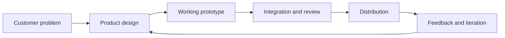

<strong>HAYCH / INDEPENDENT PRODUCT BUILDER</strong>

# Build the system. Build the business.

I work across applied AI, software product development and commercial growth. My focus is taking a customer problem from initial research through product design, technical prototyping, distribution and operational delivery.

Founder of **[Autom8r](https://autom8r.uk)** and **[KeepSide](https://keepside.uk)**. My wider work spans agent interfaces, business automation, consumer applications, market intelligence and creator-led growth.

[Selected work](#selected-work) · [Full portfolio](PROJECTS.md) · [Technical capabilities](CONTRIBUTIONS.md) · [Engineering case notes](CASE_NOTES.md)

---

## Selected work

| Product | Engineering & commercial scope | Stage |
| :--- | :--- | :--- |
| [**Autom8r**](https://autom8r.uk) | Business websites, tailored assistants, customer chat, enquiry and follow-up workflows, client acquisition | Operating agency |
| [**KeepSide**](https://keepside.uk) | Accessible dementia-support journeys, family memory vault, source-grounded assistant and permission-aware coordination | Interactive prototype |
| **JARVIS OS** | Multi-role AI workspaces, task allocation, context separation and approval flows | Configured system |
| **Agent H** | React/TypeScript calling control panel, agent configuration and webhook request flows | Private prototype |
| **Guidestick** | Collaborative embedded-assistant product, tenant-aware chat and integration design | Collaborative development |
| **Vaultara / GrowthOS** | Creative intelligence, campaign research, content operations and growth architecture | Development / design |
| **Pokewatchr** | Mobile collectibles intelligence, catalogue, market references and watchlist experience | Development |
| **PutMeForward** | AI-assisted job discovery and application-support journeys | Early prototype |
| **A8 World** | AI-agent marketplace, identity and reputation model | Research / concept |

[Explore the complete project catalogue →](PROJECTS.md)

## Capability map

| Discipline | Working scope |
| :--- | :--- |
| **Software engineering** | Python, TypeScript, JavaScript, React, PHP, SQL/MySQL; interface state, forms, CRUD and relational data |
| **Applied AI** | Knowledge-grounded assistants, agent configuration, orchestration, human review and escalation |
| **Systems integration** | HTTP APIs, webhooks, workflow automation, integration boundaries and status handling |
| **Product design** | Accessible user journeys, mobile-first experiences, interactive prototypes, requirements and scope |
| **Commercial operations** | Client discovery, prospecting, offer design, enquiry-to-quote workflows and delivery |
| **Growth & distribution** | Creator research, influencer outreach, campaign strategy, brand positioning, content and events |

## From problem to product

This is the operating model behind my work: validate the problem, build the smallest useful system, connect it to the real workflow, then test whether the experience and offer make sense.

## Beyond software

My commercial background includes running a digital services agency, previous retail and service ventures, professional influencer marketing and event coordination, premium retail sales and healthcare administration. That experience informs how I approach acquisition, trust, operational constraints and customer experience.

I am particularly interested in founding teams where product engineering, AI adoption and distribution need to work together.

## Evidence, not inflated claims

This portfolio distinguishes operating businesses, demonstrable prototypes, collaborative contributions and research concepts. Private client code and personal information are intentionally excluded. KeepSide is not clinically validated; market-system experiments do not establish trading performance.

[Engineering case notes](CASE_NOTES.md) · [Contribution breakdown](CONTRIBUTIONS.md) · [Publication standards](GITHUB_GUIDE.md)

**Collaborate:** [Open a non-confidential conversation](https://github.com/PabloH-crypt/PabloH-crypt/issues/new).
